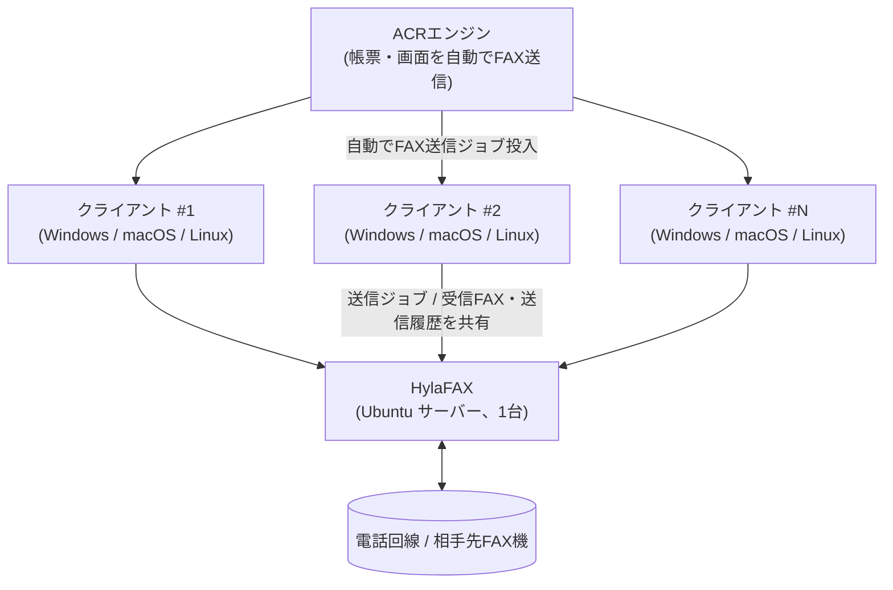

# ACR FAX

[English](README.md)

ACR FAXは、帳票エンジンであるACRの機能をHylaFAXと組み合わせることで、外部システム
（発注業務、作業報告書など）と連動したFAX送信を可能にします。また、HylaFAX本来の
画面キャプチャ・Excel/WordなどのOfficeファイル・PDFなどの送信も同時に行えるシステムです。

## 特長

- **実績あるHylaFAXをそのまま活用。** 自前でFAXプロトコルを実装するのではなく、
  長年使われてきたHylaFAXをFAXサーバーの土台にしている。HylaFAX本体には一切手を加えておらず、
  ソースを改変せずビルドしたバイナリをそのまま使用します(互換性・将来のアップデート取り込みやすさを優先)。
- **検証済みのモデム:** 現状はUSB接続のFAXモデム(Class 1 / 1.0 / 2)で動作検証済み。
  具体的には[プラネックス](https://www.planex.co.jp/product/accessories_modem.html)、
  AGPtek External USB2.0 FAX MODEM(ファックスモデム、アナログ、デュアルポート)で検証済み。
  PCI/PCIe接続のマルチポートシリアルボードでの検証は今後追加していく予定です。
- **専用の環境設定ツールがあり、モデムの自動認識に対応。** 導入時・モデム交換時に、
  接続されているモデムを自動スキャンして必要な設定を行う専用ツールを用意しています。
  (詳細は後述「モデムの設定」)。
- **サーバー接続は専用クライアントがプロトコルレベルで直接行う。** 外部コマンドをラップするのではなく
  軽量・高速に動作します。
- **クライアントはAvalonia UIで実装。** 同一コードベースでWindows/macOS/Linuxのx64/ARM64すべてを
  カバーするマルチベンダー対応を実現いたします。
- **モデムのダイヤル設定やユーザー管理も、クライアントの画面からリモートで変更可能。**
  サーバー機の前まで行かなくても設定を修正できます。
- **クライアントアプリは自己完結型。** ランタイムの個別インストールが不要で、
  配布された実行ファイルをそのまま起動します。

## 全体像

- **サーバーは1台**（Ubuntu上でHylaFAXを動かす）。FAXモデム/回線はここに接続する。
- **クライアントは複数台**がこのサーバーに接続できる。各クライアントから送信操作ができ、
  受信したFAXや送信履歴は、どのクライアントからでも同じように確認できる（特定の1台だけが
  持っているわけではない）。
- クライアントは手動操作のほか、**ACRエンジンによる自動送信**にも対応する
  （帳票データからPDFを自動生成し、人手を介さずFAX送信するルート）。

## 動作環境

- **サーバー: Ubuntu Desktop 24.04 LTSを推奨。** FAXモデム/回線に対応したシリアル・USBポートが
  必要なため、物理マシンまたはそれに準ずる環境での運用を基本とする。
- **Windows機しかない場合は、WSL2上のUbuntu 24.04でも動作する。** その場合、Windows側の
  物理メモリは最低16GB以上を推奨する。
- クライアントはWindows / macOS / Linux(x64, ARM64)に対応。

## モデムの設定

モデムの検出・udevルールの自動生成・AT通信テスト・HylaFAXサービスの再起動までを
GUIから一括で行う、Ubuntu専用の環境設定ツールを別途配布している。導入時だけでなく、
運用開始後にモデムを交換・増設した際も、このツールで接続中の全回線を自動再スキャンできる。

> **現在の状況:** クライアントアプリ v0.1.0 をテスト用に先行公開済み([Releases](../../releases/tag/acr-fax-client-v0.1.0))。
> サーバー側の実行ファイル一式はまだ同梱していないため、正式リリースはサーバーとクライアントが
> 揃ったバージョンの組として改めて出す。

## ライセンス

- 本体ソフトウェア一式: Across Report独自ライセンス(別途)
- HylaFAX: Copyright (c) 1990-1996 Sam Leffler, Copyright (c) 1991-1996 Silicon Graphics, Inc.
  (MIT/BSD系の緩い許諾ライセンス。無改造で同梱、条件は `COPYRIGHT` を参照)
