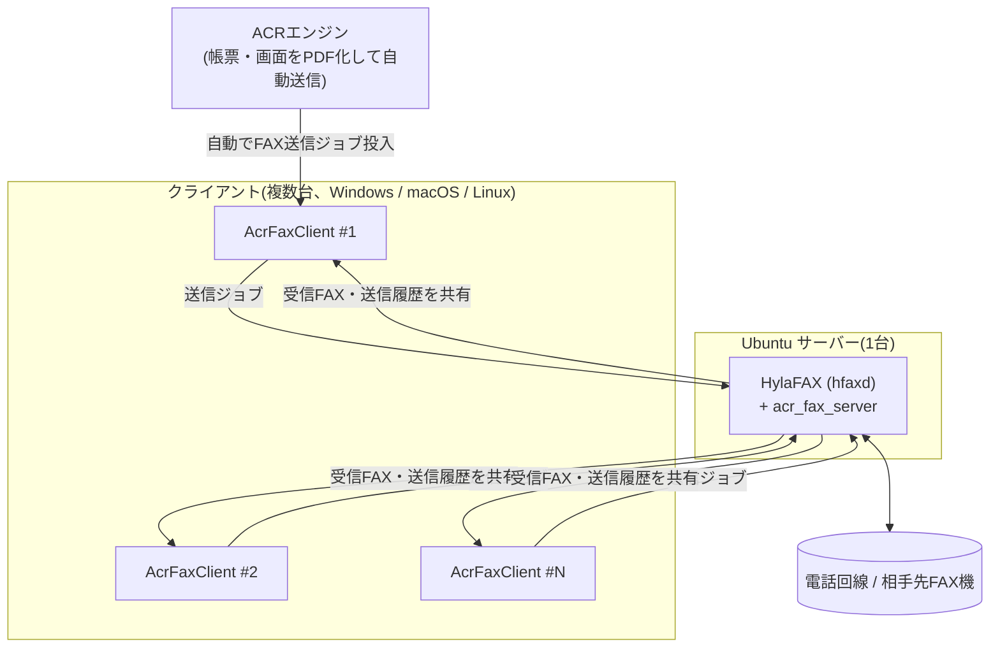

# ACR FAX

[acr_fax_server](https://github.com/acrossreport/acr-fax-server-src) と
[acr_fax_client](https://github.com/acrossreport/acr-fax-client-src) を、対応する
HylaFAX ビルド済みバイナリと合わせて配布するためのリポジトリです。

このリポジトリ自体にはソースコードは置かず、[Releases](../../releases) に
プラットフォームごとのバイナリ一式をまとめます。

## 特長

- **実績あるHylaFAXをそのまま活用。** 自前でFAXプロトコルを実装するのではなく、
  長年使われてきたHylaFAXをFAXサーバーの土台にしているため、特定機種に限定されない
  Class 1 / 1.0 / 2 対応の汎用USB FAXモデムで動作する。
- **クライアントはHylaFAX自身が持つ`hfaxd`プロトコルを直接話す。** 接続部分は
  [acr_fax_server](https://github.com/acrossreport/acr-fax-server-src)としてRustでゼロから実装しており、
  `sendfax`などの外部コマンドをラップするのではなく、プロトコルレベルで接続するため軽量・高速。
  Windows/macOS/Linuxそれぞれ単一バイナリとして配布できる。
- **HylaFAX本体には一切手を加えていない。** ソースを改変せずビルドしたバイナリをそのまま使っており、
  動作の互換性・将来のHylaFAXアップデートの取り込みやすさを保っている。
- **モデムのダイヤル設定やHylaFAXのユーザー管理も、クライアントのUIからSSH経由でリモート変更可能。**
  サーバー機の前に行かなくても設定を直せる。
- **クライアント(acr_fax_client)は自己完結型バイナリ。** .NETランタイムの個別インストールが不要で、
  配布された実行ファイルをそのまま起動できる。

## 全体像

- **サーバーは1台**（Ubuntu上でHylaFAXを動かす）。FAXモデム/回線はここに接続する。
- **クライアントは複数台**がこのサーバーに接続できる。各クライアントから送信操作ができ、
  受信したFAXや送信履歴は、どのクライアントからでも同じように確認できる（特定の1台だけが
  持っているわけではない）。
- クライアントは手動操作のほか、**ACRエンジンによる自動送信**にも対応する
  （帳票データからPDFを自動生成し、人手を介さずFAX送信するルート）。

## 含まれるもの

| コンポーネント | 対応OS/アーキテクチャ | 役割 |
|---|---|---|
| HylaFAX 7.0.11 (ビルド済み) | Ubuntu 24.04 (x64) | FAXサーバー本体。モデム/回線はここに接続 |
| acr_fax_server | Windows / macOS / Linux (x64, ARM64) | クライアント側からHylaFAXへ接続する薄いクライアント |
| acr_fax_client | Windows / macOS / Linux (x64, ARM64) | 実際に使うデスクトップアプリ本体 |

acr_fax_client は内部で acr_fax_server を呼び出すため、**両方を同じバージョンの組として配布**します
(片方だけ古いバイナリを使うと、機能不整合が起きます)。

> **現在の状況:** [acr_fax_client v0.1.0](../../releases/tag/acr-fax-client-v0.1.0) をテスト用に先行公開済み。
> acr_fax_server のビルド済みバイナリはまだ同梱していないため、正式リリースは server と揃った
> バージョンの組として改めて出します。

## ライセンス

- acr_fax_server / acr_fax_client: Across Report独自ライセンス(別途)
- HylaFAX: Copyright (c) 1990-1996 Sam Leffler, Copyright (c) 1991-1996 Silicon Graphics, Inc.
  同梱の `COPYRIGHT` を参照。

  HylaFAXのライセンス条文は「上記の著作権表示と本許諾表示をすべてのコピーに含めること」
  「Sam LefflerおよびSilicon Graphicsの名称を、事前の書面許可なく広告等に用いないこと」の
  2点を条件に、使用・複製・改変・配布・販売を無償で許諾するものです(MIT/BSD系の緩い許諾ライセンス)。
  本リポジトリではHylaFAX本体を無改造のままビルドし、`COPYRIGHT`ファイルを同梱して配布することで
  この条件を満たしています。HylaFAXまたはSilicon Graphics/Sam Lefflerの名称を使った宣伝は行いません。
