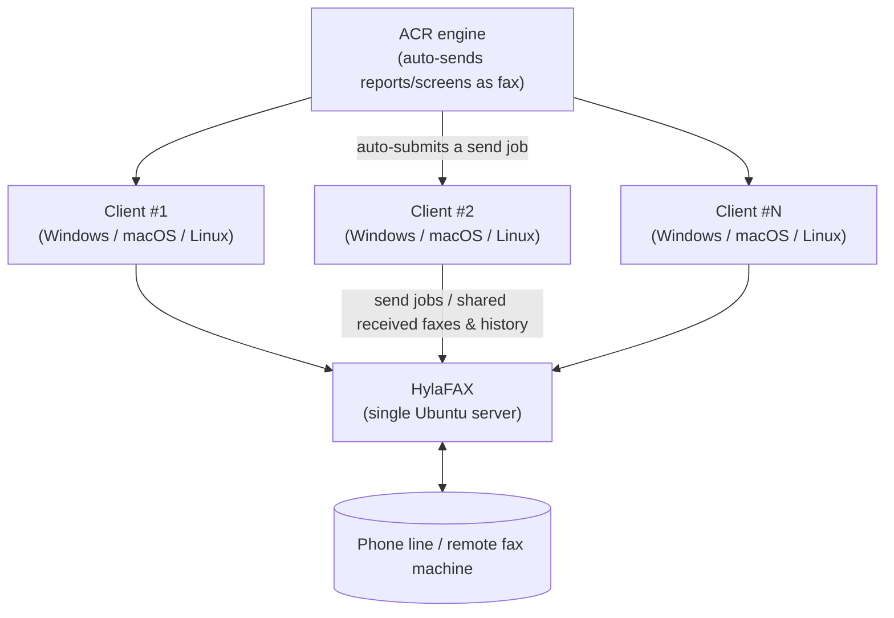

# ACR FAX

[日本語](README.ja.md)

ACR FAX combines ACR, a report-rendering engine, with HylaFAX to let external
systems (ordering workflows, work reports, and the like) trigger fax sends.
It also lets you send HylaFAX's usual targets — screen captures, Office files
(Excel/Word), and PDFs — through the same system.

## Highlights

- **Builds on HylaFAX as-is.** Rather than reimplementing the fax protocol,
  this project uses HylaFAX, which has been battle-tested for decades, as the
  server foundation. HylaFAX itself is never patched; the binaries are built
  from unmodified upstream source, to keep compatibility and make future
  upgrades easy to pull in.
- **Verified modems:** currently verified with USB-connected Class 1 / 1.0 / 2
  fax modems — specifically [Planex](https://www.planex.co.jp/product/accessories_modem.html)
  and the AGPtek External USB2.0 FAX MODEM (analog, dual-port). Verification
  with PCI/PCIe multi-port serial boards is planned.
- **A dedicated setup tool with automatic modem detection.** At install time
  and whenever a modem is swapped, a dedicated GUI tool scans connected
  modems and applies the required configuration (see "Modem setup" below).
- **The client talks to the server at the protocol level**, not by wrapping
  external commands, for lightweight, fast operation.
- **The client is built with Avalonia UI.** A single codebase covers
  Windows/macOS/Linux on both x64 and ARM64.
- **Dial settings and user management can also be changed remotely** from the
  client UI over SSH, without going to the server machine.
- **The client app is self-contained.** No separate runtime install is
  needed; just run the distributed executable.

## Overview

- **There is one server** (running HylaFAX on Ubuntu). The fax modem/line
  connects here.
- **Multiple clients** can connect to that single server. Any client can send
  a fax, and received faxes and send history look the same from every client
  (no single client "owns" that data).
- Besides manual sending, clients also support **automatic sending driven by
  the ACR engine** (auto-generate a PDF from report data and fax it without
  manual steps).

## Requirements

- **Server: Ubuntu Desktop 24.04 LTS is recommended.** A physical machine (or
  equivalent) is the baseline, since a serial/USB port for the fax modem/line
  is required.
- **If only a Windows machine is available, running under Ubuntu 24.04 on
  WSL2 has been confirmed to work.** In that case, the Windows host should
  have at least 16GB of RAM. Testing on bare-metal Ubuntu (not WSL2) is still
  to be done.
- ARM64 hardware testing hasn't happened yet (the only realistic candidate on
  hand is something like an NVIDIA DGX Spark). The current
  `acr-fax-server-linux-aarch64.tar.gz` is cross-compiled only; real-hardware
  verification is still outstanding.
- Clients support Windows / macOS / Linux (x64, ARM64) — these are cross-built
  only so far, with real-hardware testing still to come.

## Modem setup

A dedicated Ubuntu GUI tool handles modem detection, udev rule generation, AT
command testing, and restarting the HylaFAX service, all in one place. Beyond
initial setup, it can also re-scan every connected line whenever a modem is
swapped or added later during operation.

Verified modems: [Planex](https://www.planex.co.jp/product/accessories_modem.html)
and the AGPtek External USB2.0 FAX MODEM (analog, dual-port).

> **Current status:** [v0.1.0](../../releases/tag/acr-fax-v0.1.0) has been
> published early for testing, with the client and server shipped together
> as a matched set.

## Distributed binaries

[Releases](../../releases/tag/acr-fax-v0.1.0) (v0.1.0) ships eight files:
six client archives (one per OS/CPU architecture) and two server archives
(Linux x86_64/aarch64). Each is self-contained with the runtime bundled in —
just unpack and run.

| File | Role | OS | CPU architecture | Format |
|---|---|---|---|---|
| acr-fax-client-windows-x64.zip | Client | Windows | x64 | zip |
| acr-fax-client-windows-arm64.zip | Client | Windows | ARM64 | zip |
| acr-fax-client-macos-x64.tar.gz | Client | macOS | x64 (Intel) | tar.gz |
| acr-fax-client-macos-arm64.tar.gz | Client | macOS | ARM64 (Apple Silicon) | tar.gz |
| acr-fax-client-linux-x64.tar.gz | Client | Linux | x64 | tar.gz |
| acr-fax-client-linux-arm64.tar.gz | Client | Linux | ARM64 | tar.gz |
| acr-fax-server-linux-x86_64.tar.gz | Server | Linux | x64 | tar.gz |
| acr-fax-server-linux-aarch64.tar.gz | Server | Linux | ARM64 | tar.gz |

The server (`acr_fax_server`) is meant to run directly on the Ubuntu machine
that runs HylaFAX, so it's only distributed for Linux.

## License

- The software itself: Across Report's own license (separate)
- HylaFAX: Copyright (c) 1990-1996 Sam Leffler, Copyright (c) 1991-1996
  Silicon Graphics, Inc. (a permissive MIT/BSD-style license; bundled
  unmodified — see `COPYRIGHT` for the terms)
